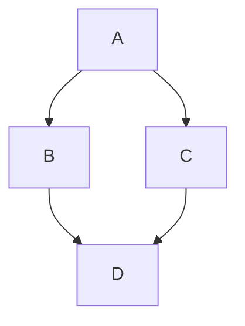

<!-- Part of data/liascript-cheat-sheet.md (see the index there). -->

## 6) Diagrams

Diagrams can be created using Mermaid. The `@mermaid` tag ensures proper rendering.

````lia

````

Alternatively, diagrams can be created with ASCII art. The syntax info `ascii` ensures correct formatting.

````lia
```ascii  Optional subtitle
  +---+      +---+
  | A | *--> | B |
  +---+      +---+
    ^          ^
    |          |
    |   .------'
    v  /
  +---+
  | C |
  +---+
```
````

---

## 7) Formulas & Equations

Mathematical formulas use LaTeX syntax.

Inline formula: $E = mc^2$

A pair of `$` starts math everywhere outside code. Write spreadsheet references, prices or other text with `$` as inline code (`` `$C$7` ``), otherwise it is set as a formula.

Block formula as separate paragraph:

$$
\sum_{i=1}^{n} i = \frac{n(n+1)}{2}
$$

---

## 8) Code & Execution

````lia
```js
console.log("Hello LiaScript!");
```
````

**Note:** Use correct language tags (`js`, `py`, `html`, etc.).

For interactive code with input fields, attach a `<script>` block or macro directly after the code block:

````lia
```js
console.log("Hello LiaScript!");
```
<script>
@input
</script>
````

---

## 9) Tables

```lia
| Era      | Feature         | Example      |
|----------|-----------------|---------------|
| Antiquity| Aulos, Lyre     | Seikilos Song |
| Baroque  | Basso continuo  | J. S. Bach    |
```

---
